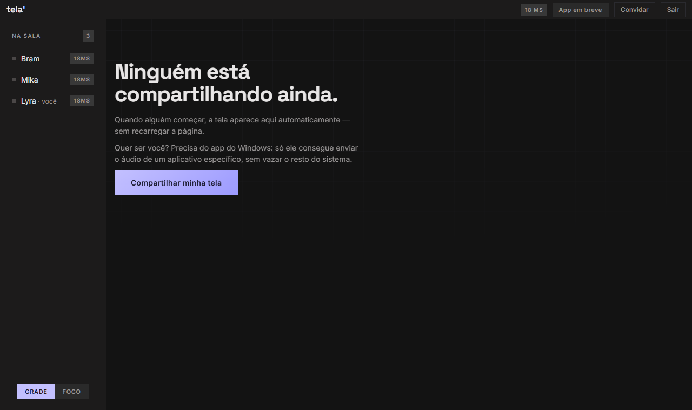

# tela'

Self-hosted **screen sharing for a group of friends**: one permanent, password-protected room where people join from the browser, see who's there, and watch each other's screens with **under one second of latency**. Sharing a window sends **only that app's audio**, never the rest of your system.

> Leia em português: [README.pt-BR.md](README.pt-BR.md)



## Why it exists

Discord's screen sharing stopped working reliably for my group of friends in Brazil. Discord is still fine for voice, chat and presence; what was missing was only the pixels. tela' does just that, and the link circulates in the Discord chat.

A Discord Activity was the first idea and was dropped: Activities don't support WebRTC, `getDisplayMedia` in their cross-origin iframe needs a permission Discord doesn't grant, and pushing frames over WebSocket is too slow. The reasoning for every decision is in [docs/spec.md](docs/spec.md).

## How it works

```
 Windows app (Rust)                       server (Docker)                      browser
┌──────────────────────────┐   WHIP    ┌────────────┐   WHEP    ┌────────────────────────┐
│ Windows Graphics Capture │──────────▶│  MediaMTX  │──────────▶│ watch: plain WebRTC,   │
│ WASAPI loopback per PID  │  WebRTC   │   (SFU)    │  WebRTC   │ nothing to install     │
│ H.264 (NVENC/QSV/AMF/x264)│          └─────┬──────┘           └───────────┬────────────┘
│ + Opus                   │                 │ auth webhook                 │
└────────────┬─────────────┘           ┌─────▼──────┐   WebSocket           │
             └────────────────────────▶│ sala (Go)  │◀──────────────────────┘
                     presence          └────────────┘   presence, ping, invites
```

- **Watching happens in the browser.** Open the site, type a nickname and the room password, done. Works on any OS and on phones.
- **Sharing needs the Windows app, on purpose.** No browser can capture the audio of one specific process: Chrome offers a tab or the whole system. Per-app audio needs WASAPI process loopback, so the sender is a small native app: a single portable `.exe`, no installer, no admin rights.
- **An SFU, not a mesh.** With 8 people in the room, peer-to-peer would make the sender upload the same stream 7 times. [MediaMTX](https://github.com/bluenviron/mediamtx) receives it once and fans it out, using ~30 MB of RAM.
- **`sala`** is a small Go service (2 MB of RAM idle): the room page, presence over WebSocket, ping measurement, and the authorizer MediaMTX calls before every publish or read.

## Features

- **Per-app audio:** sharing a window captures only that process tree; sharing a monitor captures the system audio.
- **Several screens at once** (sized for 3 streams and 8 people), shown as a grid or with one in focus.
- **Presets** for work (1080p30, 3 Mbps), sports (1080p60, 8 Mbps) and games (1080p60, 12 Mbps), with resolution, fps and bitrate adjustable.
- **Hardware encoding** picked at runtime: NVENC, Quick Sync, AMF, falling back to x264. With the `encoder-d3d11` feature the GPU encodes straight from the capture texture, with no copy back to the CPU.
- **Self-updating app:** it checks the server's manifest and downloads new versions, and fetches the ~140 MB encoder only once instead of bundling it in every update.
- **Temporary invites:** the admin creates a link valid for 1, 6 or 24 hours, revocable at any time, for people who should only watch. Nobody has to change the room password after an event.
- **Live telemetry:** ping for everyone, sent kbps/fps/dropped frames for the sender, received kbps, fps, resolution and lost frames for viewers.
- **Discord Rich Presence** showing that you're sharing, without ever leaking what (no window title or file name).

## Security

The room is protected by one shared password, so `sala` treats the rest seriously, and the tests cover it, including adversarial cases:

- **Brute force:** failed logins are rate-limited per IP with a temporary block, and the admin sees who was blocked by nickname and can unblock them. Nicknames come from the client and are rendered as hostile text.
- **Media authorization:** every WHIP/WHEP request goes through `sala`, which checks the session token and the path. It fails closed: if the check can't run, nothing streams.
- **Invites can only watch:** an invite can't publish or reach the app download.
- **Origin checking** on the WebSocket, and **ghost sessions** (connections that went silent) are dropped.
- **Logs** sent by the app mask tokens and URLs with tokens before they leave the machine.

If you put it behind Cloudflare, only trust `CF-Connecting-IP` when the origin accepts connections from Cloudflare alone; see the note in `sala/clientip.go`.

## Running the server

You need Docker with Compose, a domain pointing at the server, ports 80/443 TCP and **8189 UDP** open.

```bash
git clone https://github.com/gustavoacoelho/tela-selfhosted.git
cd tela-selfhosted
cp .env.example .env              # domain, room password, admin password
# set your server's public IP in deploy/mediamtx.yml (webrtcAdditionalHosts)
docker compose up -d --build
```

Open `https://your-domain`. Caddy gets the certificate by itself. Watching works right away; to share, build the app.

## Building the Windows app

Requires Rust and Windows with WebView2. Per-app audio needs Windows 11 (or Windows 10 build 20348+); on older builds the app falls back to system audio and says so.

```powershell
cd client
.\scripts\preparar-ffmpeg.ps1                  # ffmpeg dev libraries (LGPL) + libclang, ~230 MB
$env:TELA_SERVIDOR = "https://your-domain"     # the server baked into the app
cargo build --release -p tela-app
```

Then `deploy/montar-download.sh` assembles the `download/` folder (the app, ffmpeg, the libavcodec DLLs and the version manifest) for the server to offer. Copy it next to `docker-compose.yml` and the room page shows the download button.

The ffmpeg build is **LGPL** on purpose: it already includes NVENC, AMF, QSV and Opus, and linking a GPL build would force the whole app to be GPL.

## Tests

```bash
cd sala && go test ./...            # 89 tests: auth, throttle, invites, WebSocket, protocol
cd client && cargo test --workspace # capture, encoder selection, config, logs, updater
```

## Language

The interface, code and comments are in **Brazilian Portuguese**.

## License

MIT. MediaMTX is MIT; FFmpeg is LGPL and downloaded at build/run time, not included. The app loads libavcodec dynamically, so it stays MIT; if your server offers ffmpeg and its DLLs in `download/`, you are redistributing LGPL binaries, so keep FFmpeg's license and a link to its source alongside them.
