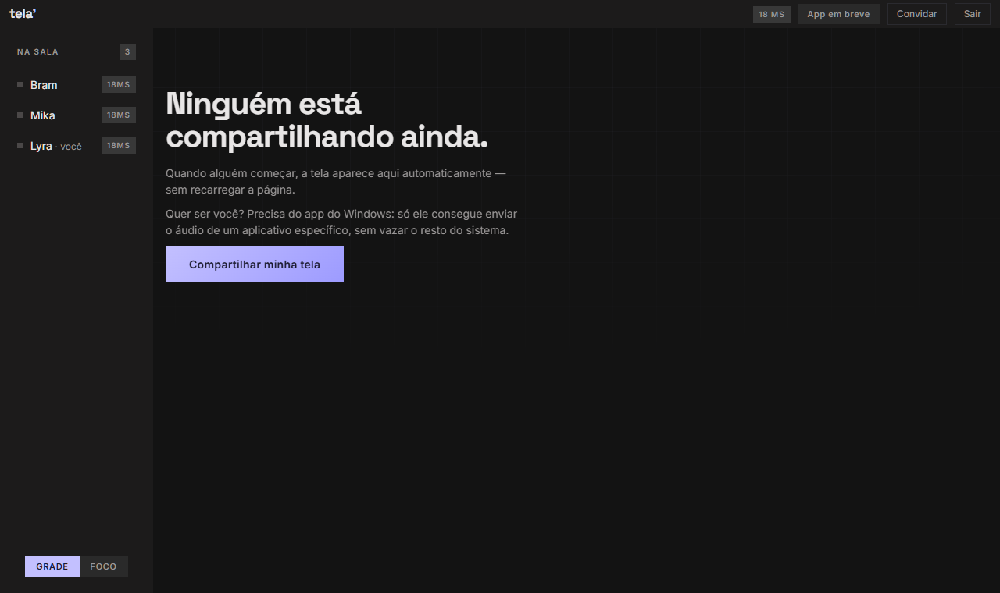

# tela'

**Compartilhamento de tela self-hosted para um grupo de amigos**: uma sala única e permanente, protegida por senha, onde as pessoas entram pelo navegador, veem quem está lá e assistem às telas umas das outras com **menos de um segundo de atraso**. Compartilhar uma janela envia **só o áudio daquele aplicativo**, nunca o resto do sistema.

> Read in English: [README.md](README.md)



## Por que existe

O compartilhamento de tela do Discord parou de funcionar direito para o meu grupo de amigos no Brasil. O Discord continua bom para voz, chat e presença; o que faltava era só o pixel. O tela' entrega só isso, e o link circula no chat do Discord.

Uma Discord Activity foi a primeira ideia e foi descartada: Activities não suportam WebRTC, o `getDisplayMedia` no iframe delas exige uma permissão que o Discord não concede, e empurrar quadros por WebSocket fica lento demais. O raciocínio de cada decisão está em [docs/spec.md](docs/spec.md).

## Como funciona

```
 app Windows (Rust)                       servidor (Docker)                    navegador
┌──────────────────────────┐   WHIP    ┌────────────┐   WHEP    ┌────────────────────────┐
│ Windows Graphics Capture │──────────▶│  MediaMTX  │──────────▶│ assistir: WebRTC puro, │
│ loopback WASAPI por PID  │  WebRTC   │   (SFU)    │  WebRTC   │ nada para instalar     │
│ H.264 (NVENC/QSV/AMF/x264)│          └─────┬──────┘           └───────────┬────────────┘
│ + Opus                   │                 │ webhook de auth              │
└────────────┬─────────────┘           ┌─────▼──────┐   WebSocket           │
             └────────────────────────▶│ sala (Go)  │◀──────────────────────┘
                     presença          └────────────┘   presença, ping, convites
```

- **Assistir é no navegador.** Abre o site, digita apelido e senha da sala, pronto. Funciona em qualquer sistema e no celular.
- **Transmitir exige o app do Windows, de propósito.** Nenhum navegador captura o áudio de um processo específico: o Chrome oferece a aba ou o sistema inteiro. Áudio por aplicativo exige o loopback por processo do WASAPI, então quem transmite usa um app nativo pequeno: um `.exe` portátil, sem instalador e sem admin.
- **SFU, não malha.** Com 8 pessoas na sala, ponto a ponto obrigaria quem transmite a subir a mesma tela 7 vezes. O [MediaMTX](https://github.com/bluenviron/mediamtx) recebe uma vez e distribui, com uns 30 MB de RAM.
- **`sala`** é um serviço pequeno em Go (2 MB de RAM em repouso): a página da sala, presença por WebSocket, medição de ping e o autorizador que o MediaMTX consulta antes de cada envio ou leitura.

## Recursos

- **Áudio por aplicativo:** compartilhar uma janela captura só aquela árvore de processos; compartilhar um monitor captura o áudio do sistema.
- **Várias telas ao mesmo tempo** (dimensionado para 3 transmissões e 8 pessoas), em grade ou com uma em foco.
- **Presets** de trabalho (1080p30, 3 Mbps), esporte (1080p60, 8 Mbps) e jogo (1080p60, 12 Mbps), com resolução, fps e bitrate ajustáveis.
- **Encoder por hardware** escolhido na hora: NVENC, Quick Sync, AMF, com recuo para x264. Com a feature `encoder-d3d11`, a GPU codifica direto da textura da captura, sem cópia de volta para a CPU.
- **App que se atualiza sozinho:** consulta o manifesto do servidor e baixa as versões novas, e busca o encoder (~140 MB) uma vez só, em vez de embuti-lo em cada atualização.
- **Convites temporários:** o admin cria um link que vale 1, 6 ou 24 horas, revogável a qualquer momento, para quem só vai assistir. Ninguém precisa trocar a senha da sala depois de um evento.
- **Telemetria ao vivo:** ping para todos; kbps, fps e quadros perdidos de quem envia; kbps, fps, resolução e quadros perdidos de quem assiste.
- **Presença no Discord** mostrando que você está transmitindo, sem nunca vazar o quê (nada de título de janela ou nome de arquivo).

## Segurança

A sala tem uma senha compartilhada, então o `sala` leva o resto a sério, e os testes cobrem isso, inclusive com casos adversariais:

- **Força bruta:** logins errados têm limite por IP com bloqueio temporário, e o admin vê quem foi bloqueado pelo apelido e pode desbloquear. O apelido vem do cliente e é exibido como texto hostil.
- **Autorização da mídia:** todo pedido WHIP/WHEP passa pelo `sala`, que confere o token da sessão e o caminho. Falha fechada: se a checagem não roda, nada transmite.
- **Convidado só assiste:** um convite não transmite nem alcança o download do app.
- **Checagem de origem** no WebSocket, e **sessões fantasmas** (conexões que emudeceram) são derrubadas.
- **Os logs** que o app envia mascaram tokens e URLs com token antes de sair da máquina.

Se colocar atrás da Cloudflare, só confie no `CF-Connecting-IP` se a origem aceitar conexão apenas da Cloudflare; veja a nota em `sala/clientip.go`.

## Rodando o servidor

Precisa de Docker com Compose, um domínio apontando para o servidor e as portas 80/443 TCP e **8189 UDP** abertas.

```bash
git clone https://github.com/gustavoacoelho/tela-selfhosted.git
cd tela-selfhosted
cp .env.example .env              # domínio, senha da sala, senha de admin
# coloque o IP público do servidor em deploy/mediamtx.yml (webrtcAdditionalHosts)
docker compose up -d --build
```

Abra `https://seu-dominio`. O Caddy tira o certificado sozinho. Assistir já funciona; para transmitir, compile o app.

## Compilando o app do Windows

Precisa de Rust e de Windows com WebView2. O áudio por aplicativo exige Windows 11 (ou Windows 10 build 20348+); em versões anteriores o app cai para o áudio do sistema e avisa.

```powershell
cd client
.\scripts\preparar-ffmpeg.ps1                  # bibliotecas do ffmpeg (LGPL) + libclang, ~230 MB
$env:TELA_SERVIDOR = "https://seu-dominio"     # o servidor que fica gravado no app
cargo build --release -p tela-app
```

Depois, o `deploy/montar-download.sh` monta a pasta `download/` (o app, o ffmpeg, as DLLs da libavcodec e o manifesto de versão) que o servidor oferece. Copie para o lado do `docker-compose.yml` e a página da sala mostra o botão de download.

A build do ffmpeg é **LGPL** de propósito: já traz NVENC, AMF, QSV e Opus, e linkar uma build GPL obrigaria o app inteiro a ser GPL.

## Testes

```bash
cd sala && go test ./...            # 89 testes: autenticação, limite de tentativas, convites, WebSocket, protocolo
cd client && cargo test --workspace # captura, escolha de encoder, configuração, logs, atualização
```

## Licença

MIT. O MediaMTX é MIT; o FFmpeg é LGPL e é baixado na compilação ou na execução, não vem junto. O app carrega a libavcodec dinamicamente, então continua MIT; se o seu servidor oferecer o ffmpeg e as DLLs em `download/`, você está redistribuindo binários LGPL: mantenha junto a licença do FFmpeg e um link para o código-fonte dele.
